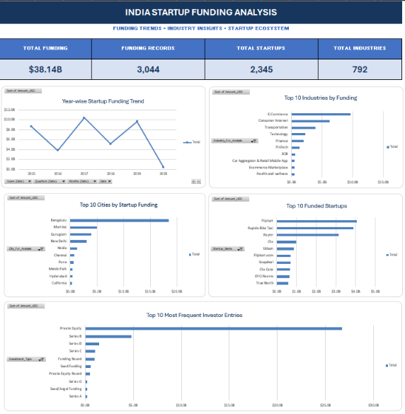

# India Startup Funding Analysis — Excel Dashboard

An Excel analysis of **3,044 Indian startup funding records (2 Jan 2015 – 13 Jan 2020)**. The workbook covers data cleaning, 7 PivotTables, 5 PivotCharts and an executive dashboard with KPI cards and written insights.



## Project Objective
Clean the raw startup funding data and summarise it in a dashboard that answers:
- How much funding was reported in total, and how did it change year by year?
- Which industries, cities and startups received the most funding?
- How is funding split across investment types?
- Which investor entries appear most often?

## Dataset
- **Records:** 3,044 funding records
- **Period:** 2 Jan 2015 – 13 Jan 2020
- **Amounts:** reported in USD
- **Source:** [(https://www.kaggle.com/datasets/sudalairajkumar/indian-startup-funding)]

## Workbook Structure
| Sheet | Purpose |
|---|---|
| `Raw_Data` | Original source data, left untouched |
| `Cleaned_Data` | Cleaned dataset, plus two helper columns for the pivots |
| `Pivot_Analysis` | 7 PivotTables that feed the dashboard |
| `Executive_Dashboard` | KPI cards, 5 PivotCharts and key insights |
| `Cleaning_Log` | Every cleaning decision |
| `Data_Dictionary` | Column definitions |

## Data Cleaning
All steps are documented in the `Cleaning_Log` sheet. No rows were removed and no values were imputed.
- Standardised column headers; kept `Sr_No` as the source record identifier.
- Removed non-printing characters and normalised whitespace.
- Parsed dates as DD/MM/YYYY and repaired eight malformed date strings.
- Standardised formatting and case variants in `Investment_Type`, and selected formatting variants in `Industry_Vertical`.
- Standardised clear city aliases (for example Bangalore → Bengaluru, Gurgaon → Gurugram).
- Replaced missing categorical values with `Unknown`.
- Converted `Amount_USD` to numeric by removing thousands separators; N/A, Unknown and Undisclosed amounts stay blank.
- Kept the source "+" qualifier for one amount in a separate `Amount_USD_Qualifier` column.
- Checked for duplicates: no duplicate `Sr_No` values and no exact duplicate rows. Repeated startup names are kept because they can be separate funding rounds.

## Analysis

### PivotTables (`Pivot_Analysis`)
1. Total funding raised
2. Year-wise funding
3. Top 10 industries by total funding
4. Top 10 cities by total funding
5. Top 10 funded startups
6. Funding distribution by investment type
7. Top 10 most frequent investor entries

### Dashboard (`Executive_Dashboard`)
**KPI cards**

| KPI | Value | How it is calculated |
|---|---|---|
| Total Funding | $38.14B | `GETPIVOTDATA`, linked to the Total Funding PivotTable |
| Funding Records | 3,044 | `ROWS` on the cleaned data table |
| Distinct Startup Names | 2,345 | `SUMPRODUCT` with `COUNTIF` (case-insensitive) |
| Distinct Industry Labels | 792 | `SUMPRODUCT` with `COUNTIF` on `Industry_For_Analysis`, blanks excluded |

**PivotCharts:** year-wise funding trend, top 10 industries, top 10 cities, top 10 funded startups, top 10 most frequent investor entries.

**Helper columns:** `Industry_For_Analysis` and `City_For_Analysis` copy the industry and city values and return blank when the value is `Unknown`, so Unknown is left out of the Top 10 pivots.

## Key Insights
1. **Bengaluru leads** with $18.5B, 48.5% of reported funding. Bengaluru, Mumbai and Gurugram together hold 71.6%.
2. **2017 was the peak year** at $10.4B (27%), followed by 2019 ($9.7B) and 2015 ($8.7B).
3. **Private Equity accounts for about 70%** of reported funding ($26.7B). Series B is next at $4.8B.
4. **Deal volume fell** from 993 records in 2016 to 111 in 2019, while the median reported deal size rose from $1M to $12M. Part of this may reflect changes in how deals were reported.
5. **Flipkart is the top funded startup** at $4.06B.

## Data Notes
- 971 of 3,044 records (31.9%) have no reported amount, so funding totals cover about 68% of deals.
- 2020 contains only 7 records (data ends 13 Jan 2020), so its low total is not a real decline.
- Rapido Bike Taxi's $3.9B Series B record (Aug 2019) looks like a source-data error. It is included in the totals above and affects the 2019, Bengaluru, Series B and top-startup figures.
- Startup names are counted case-insensitively; name variants such as Flipkart / Flipkart.com are not merged.

## Skills Used
Data cleaning in Excel, PivotTables and PivotCharts, `GETPIVOTDATA`, `SUMPRODUCT` / `COUNTIF`, helper columns, dashboard design, data documentation.

## Repository Structure
```
india-startup-funding-excel-dashboard/
├── README.md
├── India_Startup_Funding_Dashboard.xlsx
├── images/
│   └── dashboard_preview.png
├── docs/
│   └── India_Startup_Funding_Dashboard.pdf
└── data/
    └── startup_funding_raw.csv
```

## How to Open
Download `India_Startup_Funding_Dashboard.xlsx` and open it in desktop Excel (PivotCharts do not display fully in browser previews). A PDF copy of the dashboard is in `docs/`.

## Author
**Vaibhav Deshmukh** — [GitHub](https://github.com/vaibhavd8080)
